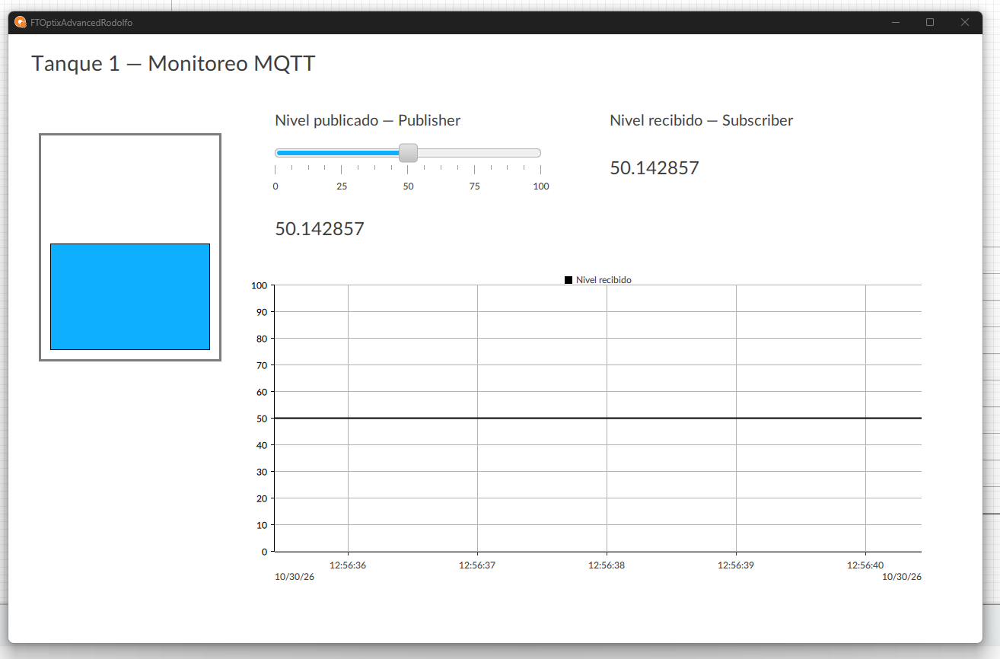

# FTOptix Advanced - Monitoreo de tanque por MQTT

Proyecto educativo de FactoryTalk Optix para publicar y recibir el nivel de un tanque mediante un broker MQTT remoto. La interfaz incluye representación del tanque, control deslizante, valores publicado y recibido, y tendencia del nivel recibido.

## Abrir el proyecto

1. Utilizar **FactoryTalk Optix Studio Desktop 1.7.3.39**, versión con la que se guardó esta copia.
2. Descargar o clonar el repositorio completo.
3. En Studio, seleccionar **Open**, buscar `FTOptixAdvancedRodolfo/FTOptixAdvancedRodolfo.optix` y abrirlo.
4. Conservar una copia antes de aceptar una actualización si se abre con otra versión de Studio.

## Configurar la conexión propia

La copia pública tiene **Broker address, Username y Password vacíos**. Cada persona debe introducir los datos de su propio broker; el proyecto no se conecta sin esa configuración.

En `MQTT > MQTTClient1`, configurar:

| Propiedad | Configuración |
| --- | --- |
| Broker address | Nombre de servidor del broker, sin prefijo de protocolo ni puerto |
| Port | `8883` |
| Client Id | Identificador único para esta instancia; evitar ejecutarlo simultáneamente en otra instancia con el mismo identificador |
| SSL/TLS enabled | `True` |
| Validate broker certificate | `True` |
| CA certificate file | `ProjectFiles/PKI/Own/Certs/isrgrootx1.pem`, incluido como certificado público de CA; utilizar la CA correspondiente si el broker propio requiere otra |
| User identity type | `Username/Password` |
| Username / Password | Credenciales MQTT del broker propio, con permiso para publicar y suscribirse a `Tank1` |

La contraseña de la cuenta web del proveedor y las credenciales MQTT pueden ser diferentes. Los secretos y las claves privadas deben permanecer fuera del repositorio.

## Modelo y MQTT

- `Model/Publisher/TankLevel`: variable **Double** controlada desde el control deslizante.
- `Model/Subscriber/TankLevel`: variable **Double** independiente que se actualiza mediante la suscripción MQTT.
- `MQTTPublisher1`: carpeta `Model/Publisher`, tema `Tank1`, muestreo **Change in value**, **QoS 2**.
- `MQTTSubscriber1/Subscriptions/DefaultJSONSubscription1`: carpeta `Model/Subscriber`, tema `Tank1`, formato JSON predeterminado de Optix. La suscripción conserva su QoS predeterminado del proyecto.
- `UI/MainWindow`: representación gráfica del tanque, control de nivel publicado, valor publicado, valor recibido y Trend enlazado al nivel del Subscriber.
- `UI/NativePresentationEngine/Start window`: `MainWindow`.

## Comprobación funcional

1. Configurar el broker propio y guardar el proyecto.
2. Ejecutar **Emulator** desde Optix Desktop.
3. En un cliente externo conectado al mismo broker, suscribirse a `Tank1`.
4. Mover el control del nivel, por ejemplo a 20, 50 y 80, dejando unos segundos entre cambios.
5. Comprobar mensajes nuevos con `TankLevel` en el cliente externo, actualización del valor recibido en Optix y cambios de la tendencia.

Las dos variables del modelo se mantienen separadas para poder comprobar el recorrido de publicación y recepción a través del broker.

## Evidencia de la interfaz

Captura de la HMI del proyecto facilitada por el participante:

## Contenido publicado

Se incluye el proyecto editable y su certificado público de CA. Se excluyen compilaciones, cachés, logs, almacenes locales de secretos, claves privadas, credenciales de autenticación y documentos del curso.
